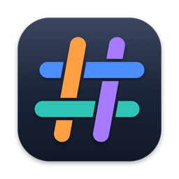
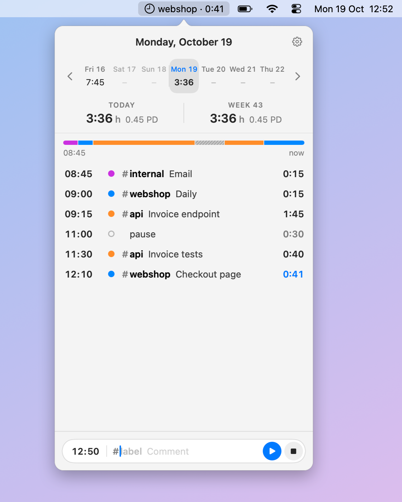
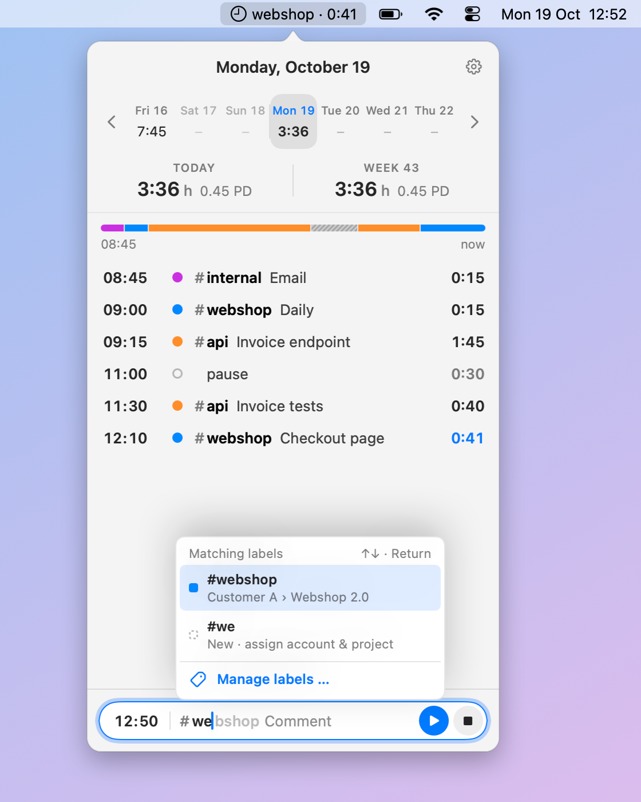
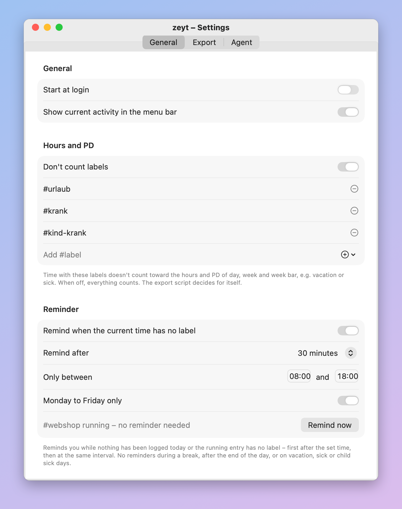
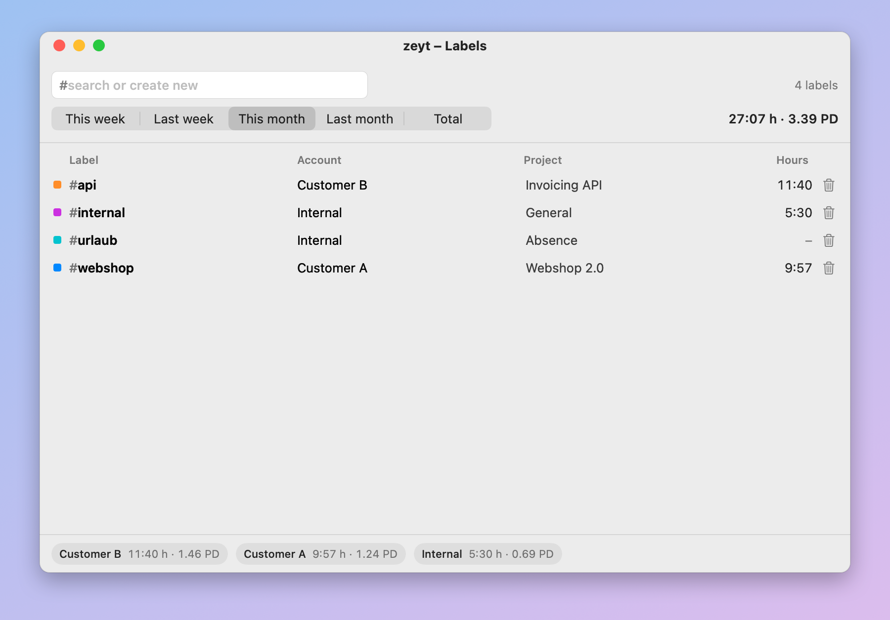
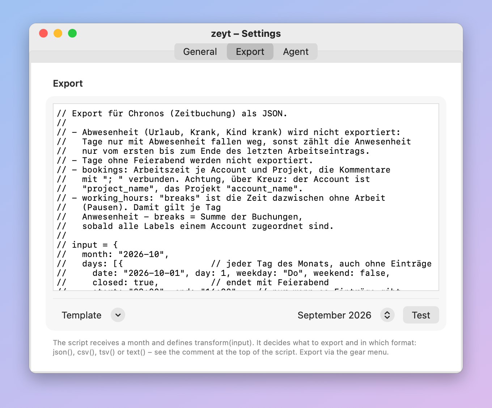

<p align="center"></p>

# zeyt

Time tracking in the macOS menu bar. Click the clock to see your day; when nothing is running,
zeyt sends a notification asking what you are working on.

<picture>
  <source media="(prefers-color-scheme: dark)" srcset="docs/screenshot-dark.png">
  
</picture>

## Features

- **Quick entries**: type `#label comment`. An entry runs until the next one; `pause` and
  `feierabend` (end of day) stop it, `#urlaub`, `#krank` and `#kind-krank` mark vacation and sick days.
- **Menu bar**: shows the running label and its duration at a glance.
- **Reminders**: a notification when no label is running, with configurable interval, hours and
  workdays. Answer it directly, continue the last task, take a break, end the day or snooze.
- **Day view**: timeline of the day, week strip, hours per day and calendar week, and person-days
  (1 PD = 8 h). Labels such as vacation or sick days can be left out of the hours.
- **Labels**: assign account and project to each label, import label lines from `.zeyt` files.
- **Copy days**: copy a day and paste it into one or more other days, also as plain text via the
  clipboard.
- **Export**: your own JavaScript turns a month into JSON, CSV, TSV or text. Templates for Chronos
  and CSV are included.
- **Agent API**: a local REST API lets AI agents such as Claude Code read and edit entries.
  “Copy prompt for agent” in the gear menu copies a ready-made prompt.
- **Local data**: a plain CSV file you can edit by hand.

<table>
  <tr>
    <td width="50%"><br>
      <sub>Type <code>#</code> and pick a label; account and project come along.</sub></td>
    <td width="50%"><br>
      <sub>Reminders: interval, hours and workdays.</sub></td>
  </tr>
  <tr>
    <td><br>
      <sub>Labels with account, project and hours per week or month.</sub></td>
    <td><br>
      <sub>Export through your own JavaScript, with templates.</sub></td>
  </tr>
</table>

Available in English, German, French, Spanish, Italian, Dutch, Polish and Portuguese (following the
system language). Requires macOS 14 (Sonoma) or later, Apple Silicon or Intel.

## Installation

```sh
brew install --cask oberbichler/tap/zeyt
```

zeyt is signed ad hoc and not notarized, so the cask removes the quarantine attribute. If you
download the ZIP from [Releases](https://github.com/oberbichler/zeyt/releases), do it yourself:

```sh
xattr -dr com.apple.quarantine /Applications/zeyt.app
```

Without permission to send notifications there are no reminders; zeyt then shows a hint in the popover.

## Data

Everything stays local in `~/Library/Application Support/zeyt`: `log.csv` (one line per entry,
`yyyy-MM-dd HH:mm,"#label comment"`) and `labels.json`.

The export (Settings → Export) calls `transform(input)` with every day of a month and returns
`json(…)`, `csv(…)`, `tsv(…)` or `text(…)`; the templates document the structure of `input`. The
agent API listens on `http://127.0.0.1:7239` and needs the token from the settings; `GET /` lists
all endpoints.

## Development

```sh
./test.sh                  # tests
./build.sh install         # build, install to ~/Applications and launch
./build.sh release 1.2.0   # universal app and cask in dist/
./docs/screenshot.sh       # screenshots for this README
```

Pushing a tag like `v1.2.0` builds the release on GitHub Actions and updates the cask in
[oberbichler/homebrew-tap](https://github.com/oberbichler/homebrew-tap) (secret `HOMEBREW_TAP_TOKEN`).

## License

[ISC](LICENSE)
