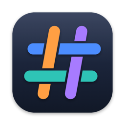
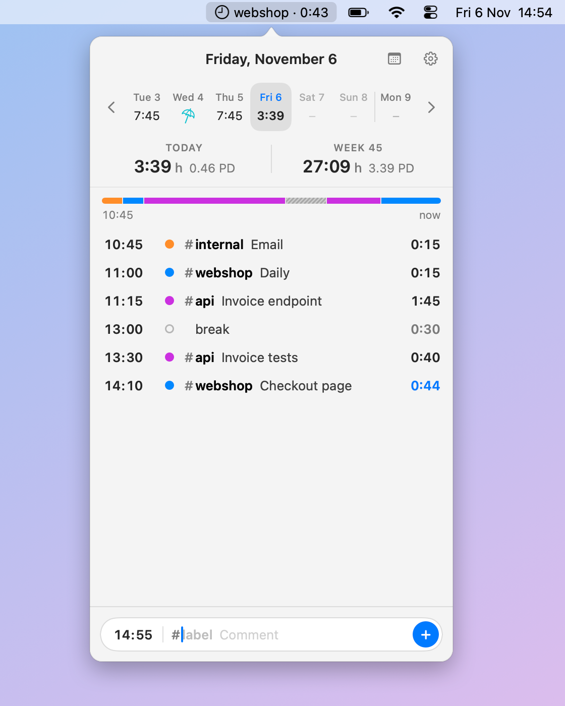
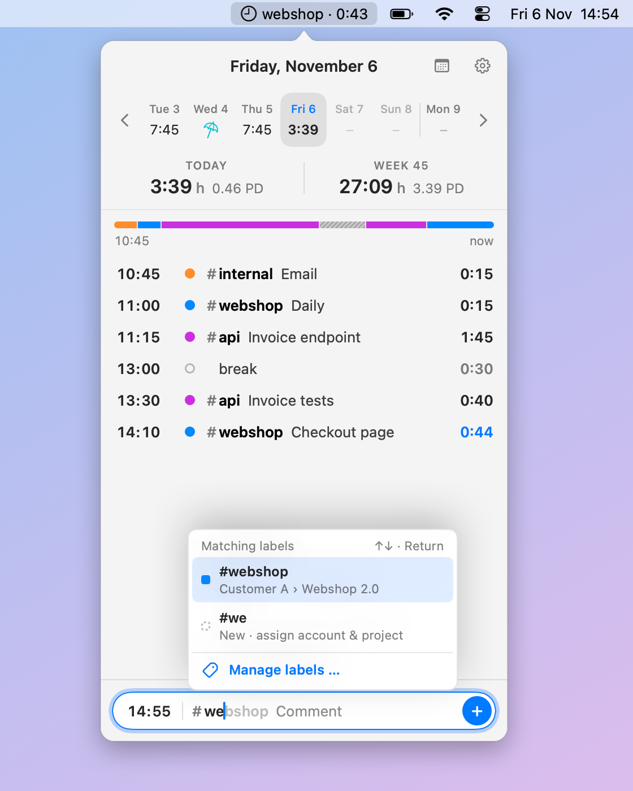
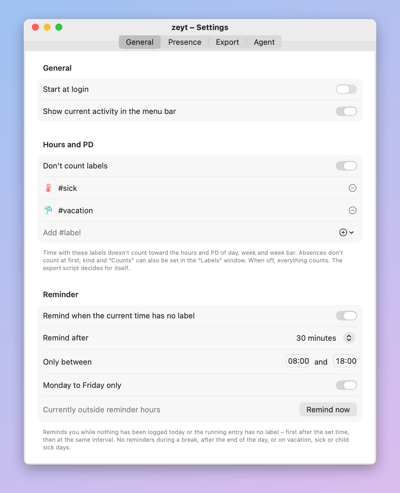
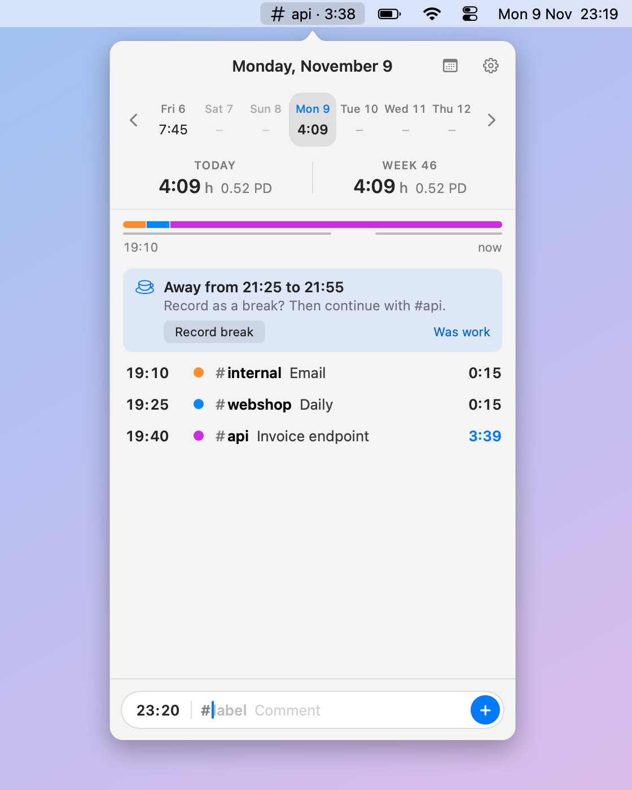
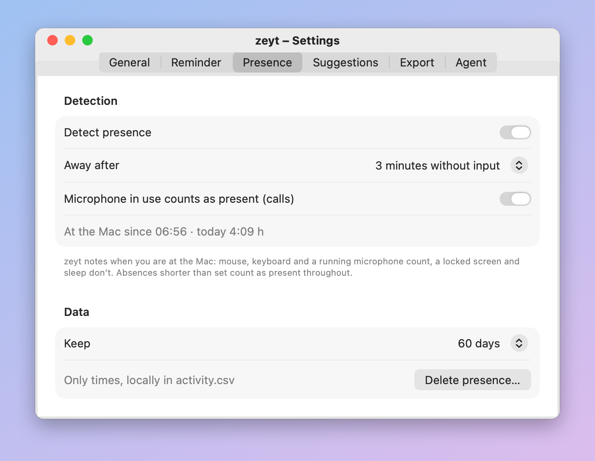
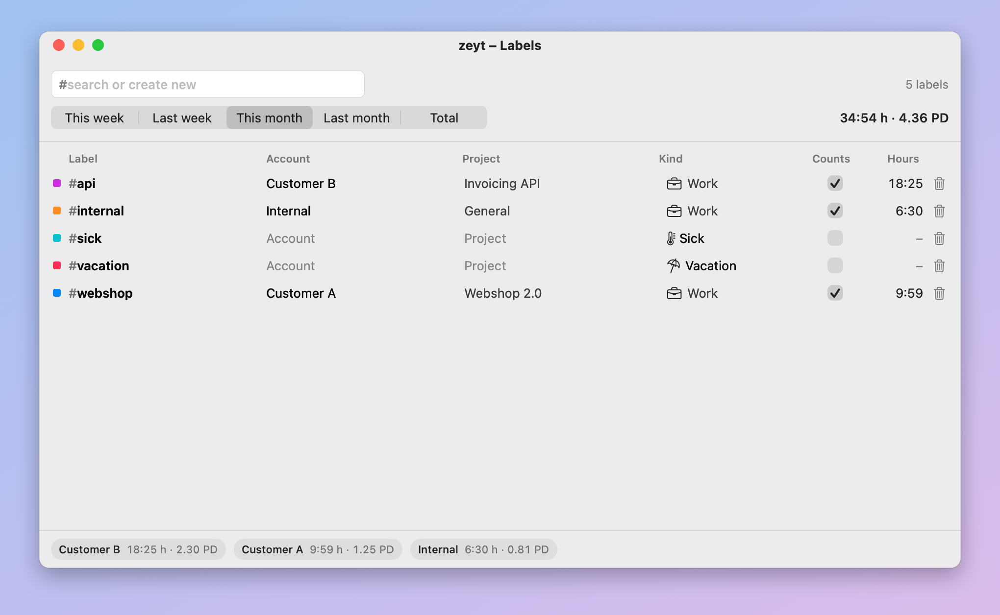
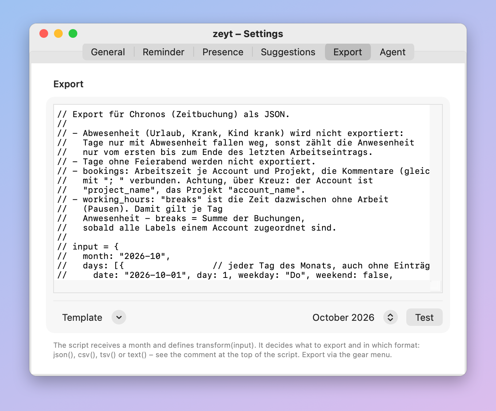
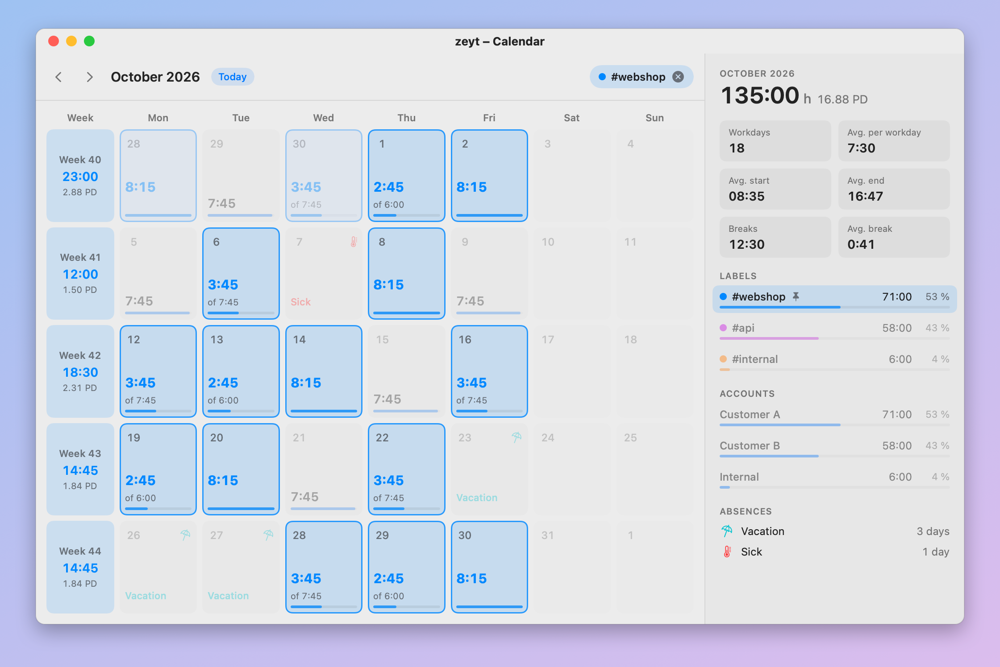

<p align="center"></p>

# zeyt

Time tracking in the macOS menu bar. Click the # in the menu bar to see your day; when nothing is running,
zeyt sends a notification asking what you are working on.

<picture>
  <source media="(prefers-color-scheme: dark)" srcset="docs/screenshot-dark.png">
  
</picture>

## Features

- **Quick entries**: type `#label comment` and press Return or +. An entry runs until the next one;
  delete the `#` to add a break instead (the last one of the day is the end of day). New users start
  with `#vacation`, `#sick` and `#child-sick`, named in their own language.
- **Menu bar**: shows the running label and its duration at a glance.
- **Presence detection**: zeyt notes when you are at the Mac (input, screen lock, sleep, a call on the
  microphone) and suggests the start of work, breaks you were away for and a forgotten end of day,
  as a banner in the popover and as a notification. Breaks can also be recorded automatically, with
  undo. A thin line under the day bar shows when you were there. Only the times are kept, locally.
  Its own settings tab sets when you count as away, which suggestions you get, rounding and how long
  the data is kept.
- **Reminders**: a notification when no label is running, with configurable interval, hours and
  workdays, and none while you are away. Answer it directly, continue the last task, take a break, end the day or snooze.
- **Day view**: timeline of the day, week strip, hours per day and calendar week, and person-days
  (1 PD = 8 h). Absences such as vacation or sick days are left out of the hours, if you like.
- **Calendar**: a month in calendar weeks with hours per day and week. Alongside, the month's
  figures: workdays, average day, start and end, breaks, hours per label and account, absences.
  Point at a label or account to highlight the days you worked on it, with the time per day;
  click to keep it. Click a day to open it.
- **Labels**: assign account and project to each label, mark labels as vacation, sick or other
  absence (icon in the overview, no reminders), choose which labels count toward the hours, rename
  labels across all entries.
- **Copy days**: copy a day and paste it into one or more other days, also as plain text via the
  clipboard.
- **Export**: your own JavaScript turns a month into JSON, CSV, TSV or text. Templates for Chronos
  and CSV are included.
- **Agent API**: a local REST API lets AI agents such as Claude Code read and edit entries, rename
  labels, read the month's figures and the detected presence, answer suggestions, change reminder and
  presence settings and run the export. “Copy Prompt for Agent” in the gear menu copies a ready-made
  prompt; your own instructions for the agent go in the settings.
- **Local data**: a plain CSV file you can edit by hand.

<table>
  <tr>
    <td width="50%"><br>
      <sub>Type <code>#</code> and pick a label; account and project come along.</sub></td>
    <td width="50%"><br>
      <sub>Reminders: interval, hours and workdays.</sub></td>
  </tr>
  <tr>
    <td><br>
      <sub>Away over lunch while a task ran: record it as a break.</sub></td>
    <td><br>
      <sub>Presence: when you count as away, suggestions, rounding, data.</sub></td>
  </tr>
  <tr>
    <td><br>
      <sub>Labels with account, project and hours per week or month.</sub></td>
    <td><br>
      <sub>Export through your own JavaScript, with templates.</sub></td>
  </tr>
</table>



Available in English, German, French, Spanish, Italian, Dutch, Polish and Portuguese (following the
system language). Requires macOS 14 (Sonoma) or later, Apple Silicon or Intel.

## Installation

```sh
brew install --cask oberbichler/tap/zeyt
```

zeyt is signed ad hoc and not notarized, so the cask removes the quarantine attribute. If you
download the ZIP from [Releases](https://github.com/oberbichler/zeyt/releases), do it yourself:

```sh
xattr -dr com.apple.quarantine /Applications/zeyt.app
```

Without permission to send notifications there are no reminders; zeyt then shows a hint in the popover.

## Data

Everything stays local in `~/Library/Application Support/zeyt`: `log.csv` (one line per entry,
`yyyy-MM-dd HH:mm,"#label comment"`), `labels.json` and `activity.csv` (when you were at the Mac, by default
the last 60 days; delete it any time in the settings).

The export (Settings → Export) calls `transform(input)` with every day of a month and returns
`json(…)`, `csv(…)`, `tsv(…)` or `text(…)`; the templates document the structure of `input`. The
agent API listens on `http://127.0.0.1:7239` and needs the token from the settings; `GET /` lists
all endpoints.

## Development

```sh
./test.sh                  # tests
./build.sh install         # build, install to ~/Applications and launch
./build.sh release 1.2.0   # universal app and cask in dist/
./docs/screenshot.sh       # screenshots for this README
```

Pushing a tag like `v1.2.0` builds the release on GitHub Actions and updates the cask in
[oberbichler/homebrew-tap](https://github.com/oberbichler/homebrew-tap) (secret `HOMEBREW_TAP_TOKEN`).

## License

[ISC](LICENSE)
